# Abductor

The Abductor is an adapter board that lets you run CW312 targets on a ChipWhisperer CW308 UFO. The UFO
takes targets on three 20-pin 2.54 mm headers, and CW312 targets have a 1.00 mm card edge. The Abductor
has the UFO header footprint and a card-edge socket, and maps every UFO target signal to the CW312 edge.
Ten edge pins have no UFO counterpart and stay unconnected: TRACECLK and TRACED0-3, nRST_OUT, VCC1.0,
VCCADJ, CLKIN_n and CLKOUT_n. A CW312 target with the standard pinout should run on the UFO unless it
needs one of those. The name fits the UFO theme: the UFO abducts the CW312 target.

A dedicated target board built for one use case is usually the better choice. When that is not practical
or not possible, the Abductor is a low-cost alternative.

There are two variants. The straight board has a vertical socket on top and needs two small corners
trimmed off each CW312 target. The right-angle board has a right-angle socket on the underside, past the
end of the UFO headers, so no target needs trimming.

In my tests with three CW312 targets and a Husky Plus, both boards matched the target plugged directly
into a CW313 baseboard ("the CW313") on every chip and debug-port ID, known-answer test, key recovery and
fault outcome. Some single-run metrics were lower through the Abductor and some higher. SAM4S SNR was
11.5 dB through the Abductor and 12.2 dB on the CW313. K82F TVLA (a fixed-vs-random leakage t-test)
reached max |t| 100.6 on the straight board and 96.0 on the right-angle board, against 65.8 on the CW313,
whose capture was noisier.

Discussion and questions:
[NewAE forum thread](https://forum.newae.com/t/abductor-a-cw312-to-cw308-ufo-adapter-board/6514).

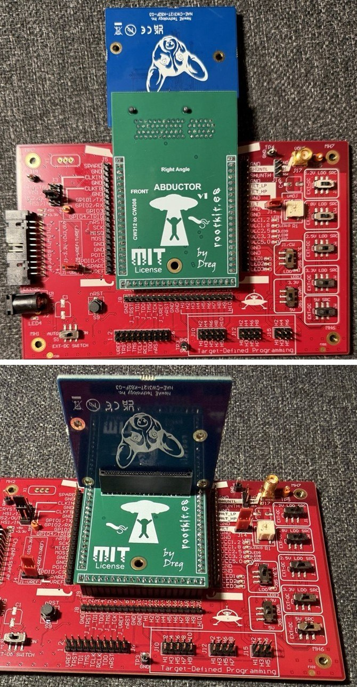

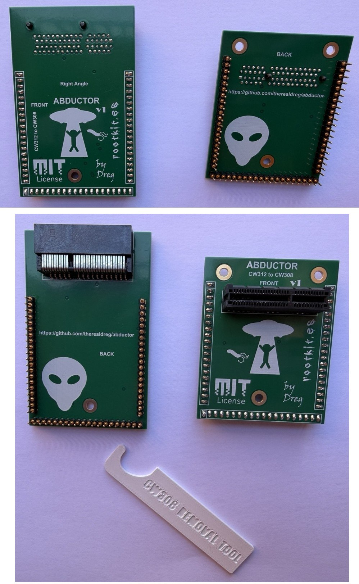

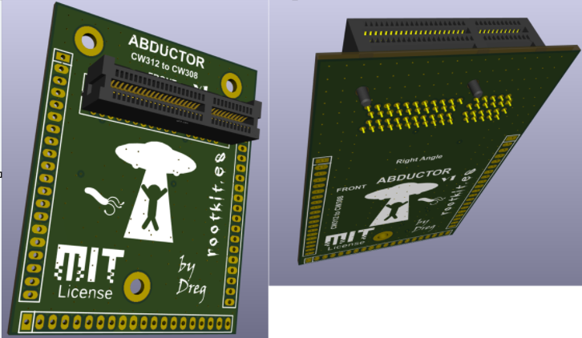

## Quick start

1. Order the boards from [prj/gerber.zip](prj/gerber.zip) (straight) or
   [prj/right_angle/gerber.zip](prj/right_angle/gerber.zip) (right-angle);
   [Ordering the PCB](#ordering-the-pcb) has the JLCPCB settings.
2. Solder one Samtec socket and three 20-pin male headers on each board
   ([Bill of materials](#bill-of-materials)).
3. For the straight board, trim two corners off each CW312 target
   ([Trimming targets for the straight board](#trimming-targets-for-the-straight-board)).
4. Plug the Abductor into the UFO and connect the Husky Plus: the 20-pin ribbon, and Measurement Pos to
   the UFO's J17 SMA, with Crowbar on a tee for glitching ([Cables](#cables)).
5. Set the UFO jumpers and switches, and add the J8 wires for SWD or JTAG
   ([UFO jumpers and switches](#ufo-jumpers-and-switches), [Debug wires on J8](#debug-wires-on-j8)).
6. Install the Python packages, change the hard-coded paths in the scripts and run them
   ([Running the scripts](#running-the-scripts)).

## Scope and limitations

All results come from one operator on one bench, with one unit of each Abductor variant, one
ChipWhisperer Husky Plus and one of each target (CW312T-SAM4S, CW312T-iCE40UP, CW312T-K82F), at
chipwhisperer commit `3c8e4347`. Most figures (SNR, TVLA t, |rho|, glitch bypass rates) come from a
single run, and unless repeats are reported I did not measure their run-to-run or re-assembly variance.
Words like "same" and "close" describe these sessions, not the hardware in general. Numbers with a plot
or an evidence file in `validation/` can be checked against it. The rest come from script console output
that is not in the repository, such as the K82F CPA, noise and mask figures, the glitch rates and the Lab
2_1B margins.

I am an enthusiast, not a professional hardware or side-channel engineer. The board and these notes may
contain mistakes or design choices a specialist would make differently. Read them as an informal
engineering log written in good faith, not as a datasheet or a qualified test report. After this testing
I consider the electrical design validated for my own use. Corrections and reviews are welcome.

## Building the board

### Ordering the PCB

Gerbers: [prj/gerber.zip](prj/gerber.zip) for the straight board and
[prj/right_angle/gerber.zip](prj/right_angle/gerber.zip) for the right-angle board. I do not work in
KiCad regularly, so review the sources and the gerbers before you order boards or rely on them.

The board carries many signals: power and shunt sensing, the HS2 clock (the ChipWhisperer high-speed
clock output), serial, the crowbar glitch path, the JTAG and SWD lines, the trigger, the LEDs and GPIO. I
chose six layers to route them comfortably. Every signal and rail runs as a 0.2 mm track on the four
inner layers. The two outer layers are ground pours, and ground fills the inner layers around the tracks.
At about 7 MHz the signal-integrity gain should be small, and my results show no consistent improvement
over a target plugged directly into the CW313. I never built a four-layer board, so I cannot say whether
it would perform the same.

The finish is ENIG. Both Samtec sockets are through-hole parts and the board has no gold-finger edge of
its own, so a cheaper HASL finish would most likely work too.

I ordered five of each variant from JLCPCB (https://jlcpcb.com/quote). It was a small, cheap order, and
the boards worked in all my tests. JLCPCB made them to this spec:

| JLCPCB parameter | Value |
|---|---|
| Base material | FR-4, TG135 |
| Layers | 6 |
| Dimensions | 54 mm × 67 mm (straight), 54 mm × 84.5 mm (right-angle) |
| Thickness | 1.6 mm |
| Outer / inner copper | 1 oz / 0.5 oz |
| Surface finish | ENIG, 1 µin gold (1U″) |
| Solder mask / silkscreen | Green / white, ink-jet |
| Via covering | Epoxy filled and capped |
| Min via | JLCPCB option: 0.3 mm hole, 0.4 to 0.45 mm diameter. The vias on both boards are 0.3 mm hole, 0.6 mm diameter |
| Electrical test | Flying-probe, full |
| Appearance quality | IPC Class 2 |
| Outline tolerance | ±0.2 mm |

### Bill of materials

| Part | Description | Link |
|---|---|---|
| Samtec PCIE-064-02-F-D-TH | Card-edge socket for the straight board: 1.00 mm pitch, 64 positions (the length of a PCIe x4 slot), through-hole | [Mouser](https://www.mouser.es/ProductDetail/Samtec/PCIE-064-02-F-D-TH?qs=iT52DjcXudu3X3%2FATBSy9g%3D%3D) |
| Samtec PCIE-064-02-F-D-RA | Right-angle version of the same socket, for the right-angle board | [Mouser](https://www.mouser.es/ProductDetail/Samtec/PCIE-064-02-F-D-RA?qs=92ilVni64gwDtfpZKan9%2FQ%3D%3D) |
| Preci-dip 800-10-020-10-001101 | Male header: 20-pin, 2.54 mm machined pin strip | [Mouser](https://www.mouser.es/ProductDetail/437-8001002010001101) |
| Preci-dip 801-87-020-10-001101 | Female socket strip: 20-pin, 2.54 mm machined, the header used on the CW308 itself. Not fitted on my boards; NewAE suggests it for sockets on its own CW308 to CW312 adapter | [Mouser](https://www.mouser.es/ProductDetail/437-8018702010001101) |

Each board takes one Samtec socket and three 20-pin male headers. The headers sit on the back of the
board, with their pins pointing down into the UFO. The PCB has no other parts: the Abductor only routes
signals.

NewAE's CW313 documentation only calls its socket the "cost-optimized CW312 card edge connector". The
CW313's Altium source in
[newaetech/chipwhisperer-target-cw313](https://github.com/newaetech/chipwhisperer-target-cw313) lists it
as a Samtec PCIE-064-02-S-D-RA. I picked the two Samtec sockets from the same PCIE series; NewAE does not
specify them. I use them only for their mechanical fit to the 1.00 mm card edge. Their PCIe signaling
rating does not matter here, since nothing on the edge comes near PCIe rates: DC rails, a clock of about
7 MHz, and slow serial, debug and GPIO lines.

### Trimming targets for the straight board

**On the straight board you have to trim two small corners off each CW312 target board**, one on each
side of the card edge. They hit the Abductor's header pins when the target is seated. The straight
board's vertical socket sits inside the UFO header frame, and the official ChipWhisperer target boards
are fixed products, so the design cannot avoid the corners. You trim each target once.

The photos show the trim on a CW312T-K82F target. The first marks the two corners. Nip each corner with
flush cutters, away from the target's mounting hole, then sand the edge, as the next two show.

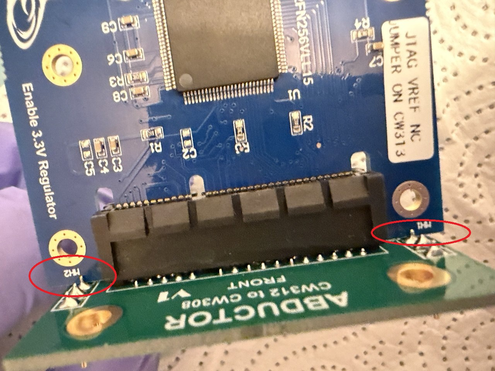

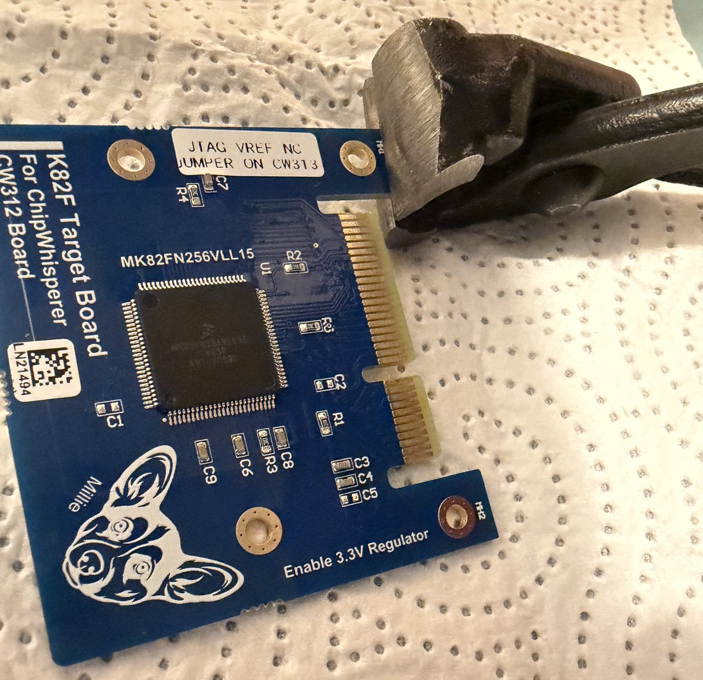

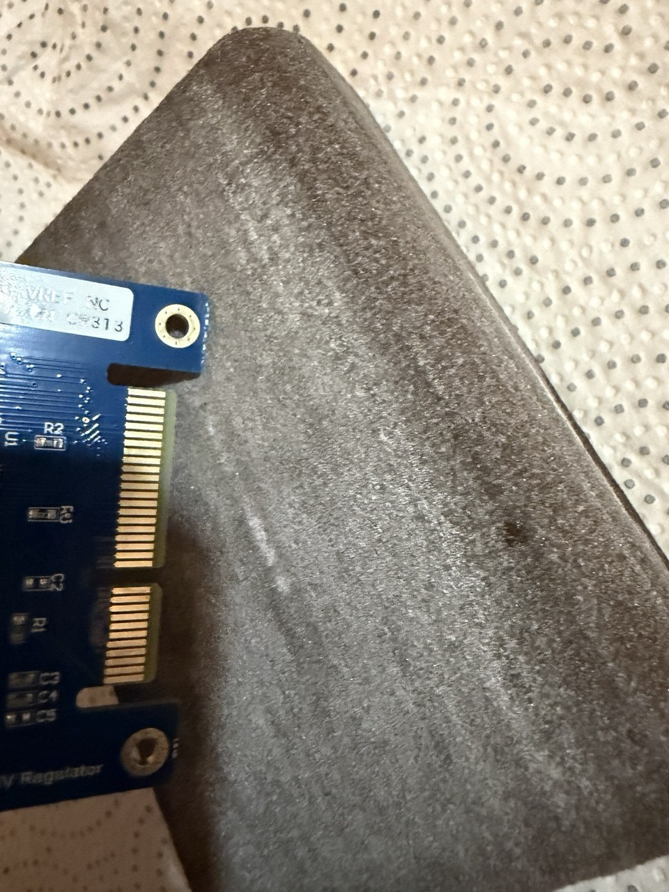

This is roughly how much of the corner to remove:

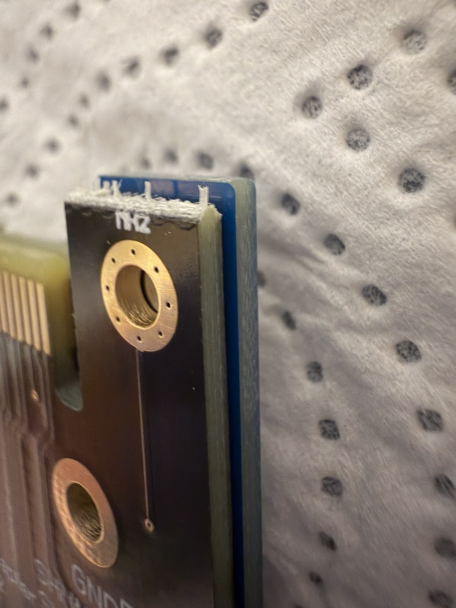

### KiCad 10 sources

The KiCad projects are in [prj/](prj/) for the straight board and [prj/right_angle/](prj/right_angle/)
for the right-angle board. The schematic comes from NewAE's `CW308T_toCW312T` design in
[newaetech/chipwhisperer-target-cw308t](https://github.com/newaetech/chipwhisperer-target-cw308t/tree/main/CW308T_toCW312T),
an Altium schematic with no PCB layout or gerbers. That design is NewAE's "CW308 to CW312 Adapter", which
goes the other way: a CW308-style target solders onto it, and its card edge plugs into a CW312 baseboard
such as the CW313. NewAE ships it in the Husky Plus kit. I did the PCB layout in KiCad. The design uses
[ViaStitching](https://github.com/dobredanielstelian/ViaStitching), a KiCad 10 port of JS Reynaud's
via-stitching plugin (`jsreynaud/kicad-action-scripts`), and uPesy's easyeda2kicad
(`pip install easyeda2kicad`), whose output targets KiCad 6 and later. I imported the two socket
footprints with easyeda2kicad. The first command is for the straight board and the second for the
right-angle board:

```
python -m easyeda2kicad --full --lcsc_id=C4597619 --output "C:\\path\\to\\project" --project-relative --overwrite

python -m easyeda2kicad --full --lcsc_id=C4571870 --output "C:\\path\\to\\project\\right_angle" --project-relative --overwrite
```

LCSC `C4597619` is the Samtec PCIE-064-02-F-D-TH and `C4571870` the Samtec PCIE-064-02-F-D-RA. The
imported footprints, symbols and 3D models are already in each project folder (`easyeda2kicad.pretty`,
`easyeda2kicad.kicad_sym` and `easyeda2kicad.3dshapes`), so you need these commands only to import them
again.

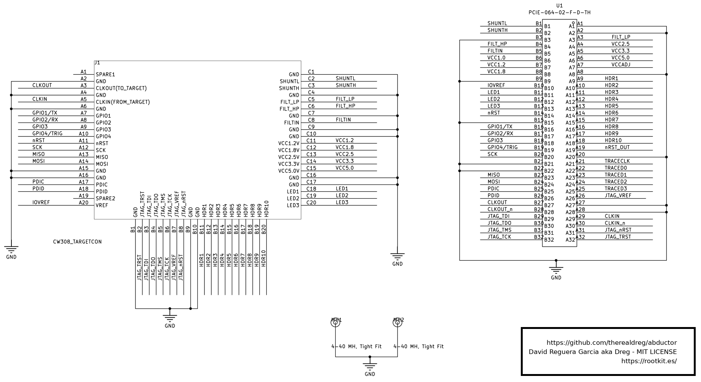

The schematic names the two clock nets from the scope side. Its `/CLKOUT` net carries HS2 to card-edge
pin B27, the target's CLKIN, and its `/CLKIN` net carries the target's clock output from edge A29 to the
UFO.

### Pin map

UFO pins A, B and C are NewAE's target headers J7 (west), J9 (south) and J11 (east). CW312 pins A and B
are the two sides of the card edge. Both boards map the pins the same way.

| Signal | UFO pin | CW312 edge pin |
|---|---|---|
| VCC1.2 | C11 | B7 |
| VCC1.8 | C12 | B8 |
| VCC2.5 | C13 | A4 |
| VCC3.3 | C14 | A5 |
| VCC5.0 | C15 | A6 |
| FILTIN | C8 | B5 |
| FILT_HP | C6 | B4 |
| FILT_LP | C5 | A3 |
| SHUNTH | C3 | B2 |
| SHUNTL | C2 | B1 |
| IOVREF (the UFO's VREF) | A20 | B10 |
| Clock to the target (UFO CLK-IN, net `/CLKOUT`) | A3 | B27 |
| Clock from the target (UFO CLKOUT, net `/CLKIN`) | A5 | A29 |
| GPIO1/TX | A7 | B16 |
| GPIO2/RX | A8 | B17 |
| GPIO3 | A9 | B18 |
| GPIO4/TRIG | A10 | B19 |
| nRST | A11 | B14 |
| SCK | A12 | B20 |
| MISO | A13 | B23 |
| MOSI | A14 | B24 |
| PDIC | A17 | B25 |
| PDID | A18 | B26 |
| JTAG_TRST | B2 | A32 |
| JTAG_TDI | B3 | B29 |
| JTAG_TDO | B4 | B30 |
| JTAG_TMS | B5 | B31 |
| JTAG_TCK | B6 | B32 |
| JTAG_VREF | B7 | A26 |
| JTAG_nRST | B8 | A31 |
| LED1 | C18 | B11 |
| LED2 | C19 | B12 |
| LED3 | C20 | B13 |
| HDR1 to HDR10 | B11 to B20 | A9 to A18 |
| GND | A2, A4, A6, A15, A16, B1, B9, B10, C1, C4, C7, C9, C10, C16, C17 | A1, A2, A8, A20, A27, A28, B3, B9, B15, B21, B22 |
| TRACECLK, TRACED0 to TRACED3 | not connected | A21, A22 to A25 |
| nRST_OUT | not connected | A19 |
| VCC1.0 | not connected | B6 |
| VCCADJ | not connected | A7 |
| CLKIN_n, CLKOUT_n | not connected | A30, B28 |
| UFO spare pins | A1, A19 | not connected |

## Using the board

Plug the Abductor into the UFO target headers like any CW308 target, then plug the CW312 target into the
Abductor's socket. The Abductor has no jumpers or settings. To pull it off the UFO without stressing or
damaging the PCB I use a 3D-printed removal tool:
https://github.com/therealdreg/removal_tool_cw308_ufo_chipwhisperer

The software needs no change for the Abductor. The same scripts in `validation/scripts/` and the same
target builds ran on the CW313 and on both boards: `PLATFORM=CW312_SAM4S` for the SAM4S, the
`iCE40UP5K_SS2` bitstream for the iCE40 and `PLATFORM=CW308_K82F` for the K82F.

### Cables

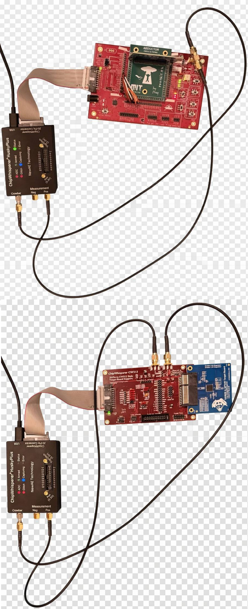

The Husky Plus connects to the UFO with two cables, as in the photo:

- The 20-pin ribbon, from the Husky Plus "20-Pin Connector" to the UFO's 20-pin header J1. It carries the
  HS2 clock, serial on TIO1 and TIO2, the trigger on TIO4, nRST, PDIC, the SPI lines and the 3.3 V that
  powers the UFO. NewAE rates that 3.3 V at 200 mA, and the 20-pin 5 V pin is connected only on a CW-Pro,
  so the UFO runs on 3.3 V alone.
- An SMA cable from "Measurement Pos" to J17, the UFO's only SMA (silkscreen VOUT). Its center pin is
  SHUNTL, the low side of the shunt resistor on the CW312 target. For voltage glitching, put an SMA tee
  on J17 and run a second cable from "Crowbar" to it. The tee that came with the UFO works;
  [Bypass rate by tee and setup](#bypass-rate-by-tee-and-setup) compares it with an Amphenol 132217.

"Measurement Neg", "Trig/Glitch" and "Aux" stay unused. For single-ended measurement NewAE recommends
fitting the short-circuit cap that ships with the Husky on Measurement Neg, which makes the trace
slightly less noisy; my bench ran without it. On the CW313 the two SMAs are wired together, so Crowbar
and Measurement Pos take one each and need no tee.

### UFO jumpers and switches

These settings run all three targets from the Husky Plus alone, with nothing on the UFO's DC jack. The
bench photos show the J3, J4 and J14 caps fitted and J16 open, but the regulator switches are too small
to read in them, so the switch settings below follow from what the targets need.

| Jumper or switch | Setting | Why |
|---|---|---|
| J3, clock | HS2/OUT to CLKIN, the NewAE default | sends the Husky Plus HS2 clock to the target CLKIN. The other positions take the X1 crystal or send CLKFB, the target's clock output, to the ChipWhisperer |
| 3.3V SRC switch | J1/CW | takes 3.3 V straight from the 20-pin cable. The LDO position needs a DC supply or the CW-Pro 5 V |
| 1.2V LDO SRC switch | J1 | feeds the 1.2 V LDO from the ChipWhisperer 3.3 V. The SAM4S and the iCE40 take their 1.2 V core supply from it; the K82F (revision -03, the board used here) runs on 3.3 V only |
| J14, filter input | FILT, the NewAE default | the target feeds its core supply into the UFO filter through FILTIN (CW312 edge B5). The VADJ position feeds the filter from the adjustable LDO instead: set its voltage first, because the SAM4S and iCE40 cores run at 1.2 V |
| J16, shunt | open | a cap across SH- and SH+ shorts the shunt and removes the power signal. A cap across GND and SH- shorts the target supply to ground through the shunt: on the K82F that is about 330 mA from the Husky Plus 3.3 V, which is rated at 200 mA |
| J4, VREF | J5-VREF (the NewAE default) or CW 3.3 V | sets the clamp level of the 20-pin I/O lines. J5-VREF takes it from the target's VREF pin, which the Abductor carries to CW312 edge B10 (IOVREF), and all three targets drive that pin at 3.3 V. CW 3.3 V sets the same 3.3 V from the 20-pin cable. The close-ups with the K82F appear to show the cap on the CW 3.3 V side |
| EXT-DC switch | either | matters only with a DC supply on the jack |

These targets use none of the other supplies, so the 1.8V, 2.5V and 3.3V LDO SRC switches, the 5V SRC
switch, the VADJ SRC switch and the VADJ trimmer can stay as they are.

On the CW313, JP2 stays on target GPIO4 (the default) for the trigger, and the JP3 caps make the debug
bridge described in [SWD and JTAG debug](#swd-and-jtag-debug).

### Debug wires on J8

The UFO has no JP3 jumpers like the CW313's, so SWD and JTAG on the SAM4S, and flashing the K82F, need
jumper wires on the UFO from J5, the pin header next to J4 that carries the target connector's
ChipWhisperer signals, to the JTAG pins of J8. J8 is printed, from the left: GND, J_TRST, J_TDI, J_TDO,
J_TMS, J_TCK, J_VREF, nRST, GND, GND, then H1 to H10. The silkscreen font draws a V like a U, so J_VREF
can read as J_UREF (and VREF on J5 as UREF). Ground is already common through the 20-pin ribbon. SWD
needs wires 1 to 3, and full JTAG adds 5 and 6:

| Wire | From | To (J8) | Role |
|---|---|---|---|
| 1 | `SCK` | `J_TCK` | SWCLK |
| 2 | `PDID/CS` | `J_TMS` | SWDIO |
| 3 | `VREF` | `J_VREF` | JTAG_VREF for the pull-ups |
| 4 | `nRST` | `J_TRST` (SWD, K82F) or `nRST` (JTAG) | optional; OpenOCD drives no reset |
| 5 | `MOSI` | `J_TDI` | TDI, full JTAG only |
| 6 | `MISO` | `J_TDO` | TDO, full JTAG only |

SWD needs wire 3: without it OpenOCD failed with `cannot read IDR` in my setup. Wire 4 is optional, and
the logs show it on two different pins. The SWD and K82F sessions ran it to J_TRST, which reaches JTAG
TRST at CW312 edge A32 (unconnected on the SAM4S and the iCE40, PTA5/TRST on the K82F). The JTAG session
ran it to J8's nRST, which reaches edge A31 (JTAG_nRST, which the SAM4S ties to its nRST). OpenOCD drove
no reset line in any session. Take all these wires off before you use the iCE40. They tie `nRST`, `VREF`
and the SPI lines to the `J8` JTAG pins, and in my tests the iCE40's SS2 serial only worked without them.

## Validation

I tested the board on ChipWhisperer hardware one demo at a time, in the course order starting with
`sca101`, and checked each result before moving on. The tests check that the Abductor carries the signals
each demo needs and gives valid side-channel data.

The tests ran on three setups with the same targets and Husky Plus: the straight board, the right-angle
board, and the CW313, where the target plugs directly into the CW313 baseboard with no UFO and no
adapter. Results are from the straight board unless a section says otherwise. In file names and script
labels, `abductor` means the straight board.

The right-angle board's socket is a right-angle part, so its traces are a little longer and routed
differently. That could add series inductance and loop area on the crowbar/VOUT and shunt paths, or
slightly reduce the measurement bandwidth. I re-ran all three targets through it with the same Husky
Plus, UFO and scripts, one test at a time, and reconnected the Husky Plus USB between tests. A test that
failed on the first attempt was re-run after a USB reconnect.

### Results

In the verdict column, identical means a bit-exact match of a fixed value (IDs, known-answer tests). Same
means the same outcome or count. Close means a difference these runs cannot resolve, so a small effect is
neither shown nor ruled out. Glitch points are (width, offset, ext_offset): width and offset are in Husky
phase-shift steps, and ext_offset is in target clock cycles after the trigger.

| Test | Metric | Straight | Right-angle | CW313 | Verdict |
|---|---|---|---|---|---|
| Bring-up | traces, serial echoes | 10/10, 10/10 | 10/10, 10/10 | 10/10, 10/10 | same |
| Bring-up | mean trace peak-to-peak (normalized ADC units) | 0.57 | 0.68 | 0.62 | within 19%, one run each |
| CPA (AES) | full key | yes | yes | yes | same |
| CPA | traces to rank 0 (all 16 key bytes ranked first) | 30 | 30 | 30 | same |
| DPA (AES) | full 16-byte key | yes | yes | yes | same |
| Password SPA | recovered | `h0px3` | `h0px3` | `h0px3` | same |
| Password SPA | winner margin | 22x to 24x | 23x to 25x | 23x to 24x | close |
| SNR | peak, 1500 traces | 14.1 (11.5 dB) | 14.0 (11.5 dB) | 16.7 (12.2 dB) | CW313 18% higher (linear) |
| TVLA | max \|t\| (3000 traces, threshold 4.5) | 60.7 | 59.5 | 60.7 | close |
| GPIO3 | TIO3 toggles | yes | yes | yes | same |
| SWD | DPIDR, chip ID | `0x2ba01477`, `0x288b07e1` | `0x2ba01477`, `0x288b07e1` | `0x2ba01477`, `0x288b07e1` | identical |
| JTAG | TAP IDCODE | `0x4ba00477` | `0x4ba00477` | `0x4ba00477` | identical |
| Voltage glitch, high-power | best cell found (width, offset, ext_offset) | (1950, 2480, 129) | (2000, 2450, 129) | (1950, 2460, 129) | same ext_offset, offsets 2450 to 2480 |
| Voltage glitch, high-power | batch bypass rate (200 attempts) | 49.5% | not measured | 40.5% | gap not resolved (p about 0.07) |
| Voltage glitch, high-power | peak bypass rate (40 attempts at the best cell) | 78% and 98% (Amphenol tee), 55% (stock tee) | 90% (36/40) | 85% (34/40) | bypasses on all three; single runs do not rank them |
| Voltage glitch, low-power | crashes at repeat 1, 2, 4, 8 | none at 1, all at 2 to 8 | none at 1, all at 2 to 8 | none at 1, all at 2 to 8 | same threshold |
| Clock glitch | faults the SAM4S | yes | yes | yes | same |
| LED1, LED2, LED3 | blink in sequence | yes | yes | yes | same |
| Memory dump | crowbar on the send loop | 510 bytes at (2000, 2480, 2122), no secret | 510 bytes at (1900, 2200, 88), contains the secret | 510 bytes at (2000, 2480, 2122) | same fault and length; the right-angle glitch point differs |
| iCE40 AES | known answer `AES(0,0)` | `66e94bd4...` | `66e94bd4...` | `66e94bd4...` | identical |
| iCE40 CPA | traces to full key (grid ..., 2000, 3000) | 3000 | 3000 (repeat; first run 5000) | 3000 | same |
| iCE40 TVLA | max \|t\| (4000 traces, threshold 4.5) | 85.0 | 85.8 | 89.3 | within 5% |
| iCE40 DFA (differential fault attack) | full key (phoenixAES, round-8 and round-9 faults) | 16/16 | 16/16 | 16/16 | same |
| K82F AES | known answer `AES(2b7e..,00..0f)` | `50fe67cc...` | `50fe67cc...` | `50fe67cc...` | identical |
| K82F TVLA | max \|t\| (8000 traces, threshold 4.5) | 100.6 | 96.0 | 65.8 | all far above 4.5, wide spread |
| K82F CPA | byte-0 \|rho\| (50k traces; right-angle 30k) | 0.104 | 0.104 | 0.095 | close (standard error about 0.005 each) |
| K82F CPA | full AES key, disjoint-set attack | not recovered (1/16 at 50k, 0/16 at 30k) | not recovered (0/16 at 30k) | not recovered (0/16) | same; the limit is the target (one control run) |

Traces to rank 0 is a single-run count on a coarse trace grid. It depends on the data, can change from
run to run, and is not a guessing-entropy average (the mean rank of the correct key over many runs).

## CW312T-SAM4S

### Bring-up

All six steps of a smoke test passed, so the Abductor routes clock, power, serial, ERASE and nRST, and
the chain from the Husky Plus through the UFO and the Abductor to the SAM4S works. The test builds
`simpleserial-base`, flashes it over SAM-BA and captures traces. Steps 2 to 5 each exercise a different
path through the Abductor. Script: [`smoke_bringup.py`](validation/scripts/smoke_bringup.py).

| # | Step | Abductor path | Result |
|---|---|---|---|
| 0 | Connect to the Husky Plus | none (scope only) | `cwhuskyplus`, FW 1.2.0 |
| 1 | Build the SAM4S firmware | none (host build) | `simpleserial-base-CW312_SAM4S.hex`, ROM 2.17% of 128 KB |
| 2 | Flash over SAM-BA (ERASE=`pdic`, `nrst`) | control and reset lines | program and verify OK in 5.0 s |
| 3 | Bidirectional UART, echo of the `p` command | serial TX and RX | 10/10 echoes correct |
| 4 | Trigger and capture | trigger and sync | 10/10 traces, 5000 samples each |
| 5 | Clock and power measurement | HS2 clock, shunt and SMA | mean per-trace peak-to-peak 0.57 and global sample std 0.14 (normalized ADC units), clean clock cycles |

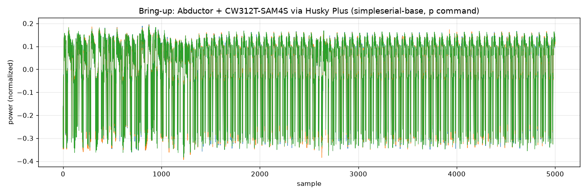

### Side channel (sca101)

Every lab I ran passed. The `sca101` course builds up from timing differences to a full AES key recovery.
I skipped Lab 3_2, which is software only, and Lab 4_1, a low-impact stepping stone. Labs 4_3, 5_1 and
6_4 are pending.

| Lab | Title | Firmware | Result |
|---|---|---|---|
| 2_1A | Instruction power differences | simpleserial-base | pass |
| 2_1B | Power analysis for password bypass | basic-passwdcheck | pass |
| 3_1 | Large Hamming weight swings | simpleserial-aes (TINYAES128C) | pass |
| 3_2 | Recovering data from a single bit | none | skipped (software only) |
| 3_3 | DPA on firmware implementation of AES | simpleserial-aes (TINYAES128C) | pass, full key |
| 4_1 | Power and Hamming weight relationship | simpleserial-aes | skipped |
| 4_2 | CPA on firmware implementation of AES | simpleserial-aes (TINYAES128C) | pass, full key in 30 traces |
| 4_3 | ChipWhisperer Analyzer CPA attack | simpleserial-aes | pending |
| 5_1 | ChipWhisperer CPA attacks in practice | simpleserial-aes | pending |
| 6_4 | Jittery triggering on UART | simpleserial-aes (TINYAES128C) | pending |

#### Lab 2_1A: instruction power differences

I inserted different instruction blocks between `trigger_high()` and `trigger_low()` in
`simpleserial-base`, then built (ChipWhisperer's default `-Os`), flashed and captured each one. As the
lab instructs, I removed the serial response (`simpleserial_put`) from `get_pt()`, so no reply follows
the block. The framework still sends its `z00` ack. `capture_trace` reads it in place of the missing `r`
packet, warns `Unexpected start to command` and keeps the trace. Serial stays in sync because
`simpleserial_write` flushes the receive buffer before each command. Script:
[`lab_2_1A.py`](validation/scripts/lab_2_1A.py).

The cost of each block is the trigger duration, `scope.adc.trig_count`. That counter counts ADC samples:
at `adc_mul=4` there are 4 samples per core clock cycle, so the counts are 4 times the core cycles.

| Instruction block | Trigger duration (ADC samples) | Cost against baseline |
|---|---|---|
| baseline (empty) | 492 | reference |
| 20x `A *= 2` (unrolled multiply) | 992 | +500, 25 ADC samples (6.25 core cycles) per volatile statement |
| loop x20 `A *= 2` (multiply) | 2132 | +1640, 82 ADC samples (20.5 core cycles) per iteration |
| loop x20 `A /= 3` (integer divide) | 2276 | +1784, 144 more than the multiply loop |

- The count was identical in all 15 captures of each block (min equals max), as expected from
  deterministic code clocked in step with the ADC. That is consistent with the count coming back through
  the Abductor uncorrupted. The right-angle board gave the same four counts.
- The unrolled block adds a flat cost per statement. The loop costs far more than the same 20 multiplies
  unrolled. That extra fits per-iteration loop overhead (the volatile counter load and store, compare and
  branch), but the measurement only records the total.
- The divide loop costs more than the multiply loop. `A` is a `volatile long int`, so `A /= 3` is integer
  division. The compiler can emit the multi-cycle Cortex-M4 `SDIV` or, for a constant divisor like 3, a
  multiply-and-shift sequence, and the repository has no listing to tell which. The trigger duration
  cannot tell the two apart either, so it does not prove an `SDIV` ran.

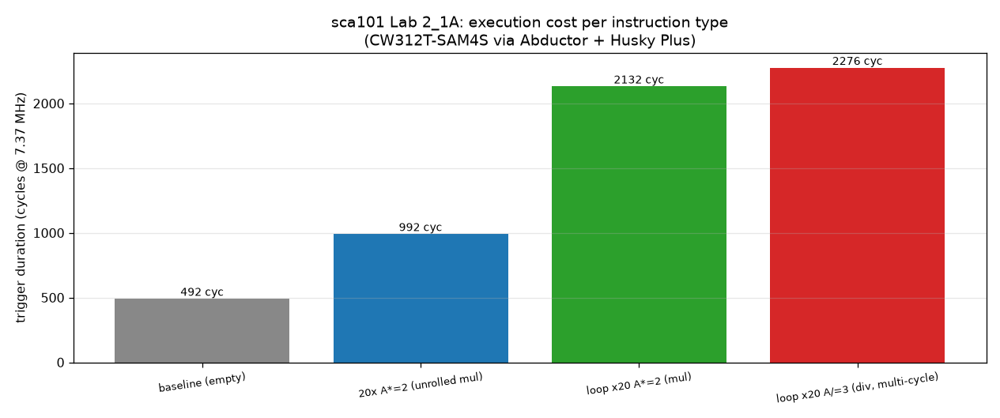

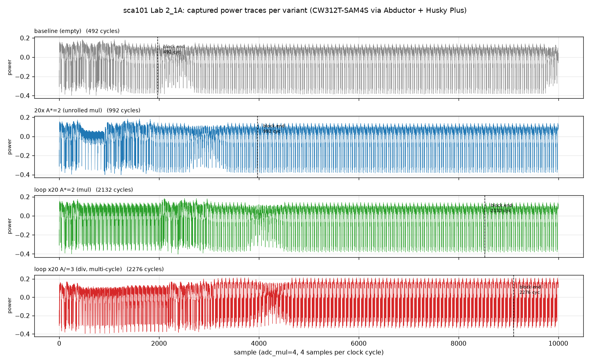

Both figures label the counts as cycles and draw the block end at four times the count. The counts are
ADC samples, so the blocks end at samples 492, 992, 2132 and 2276, and `lab_2_1A.py` labels and draws
them that way.

#### Lab 2_1B: power analysis for password bypass

The power traces recover the password of `basic-passwdcheck`, `h0px3`, which matches the firmware
constant. The correct character wins every position by 22x to 24x. The firmware checks the password one
character at a time and stops at the first wrong one. Each correct character runs one more loop
iteration, so the trace stays active longer before it diverges. The attack captures one trace per
candidate character, scores it against a wrong-character reference with the sum of absolute differences
(SAD), keeps the best score, and moves to the next position with the known prefix. Script:
[`lab_2_1B.py`](validation/scripts/lab_2_1B.py).

| Position | Recovered char | SAD (winner) | SAD (2nd best) | Margin |
|---|---|---|---|---|
| 0 | `h` | 286.6 | 11.9 | 24.0x |
| 1 | `0` | 284.6 | 12.4 | 22.9x |
| 2 | `p` | 280.3 | 12.7 | 22.1x |
| 3 | `x` | 274.5 | 12.4 | 22.1x |
| 4 | `3` | 301.7 | 12.3 | 24.4x |

Margins come from the full-precision SAD values, so they can differ slightly from dividing the rounded
columns. In the divergence plot the correct and wrong first-character traces overlap until the compared
byte and split around sample 430.

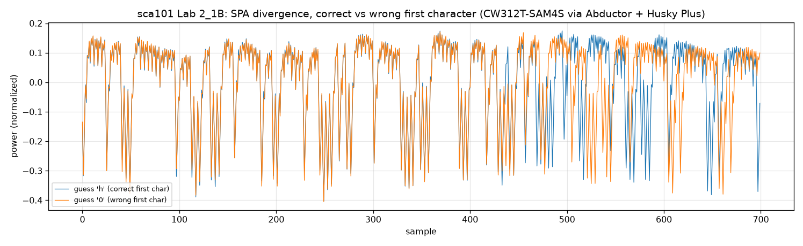

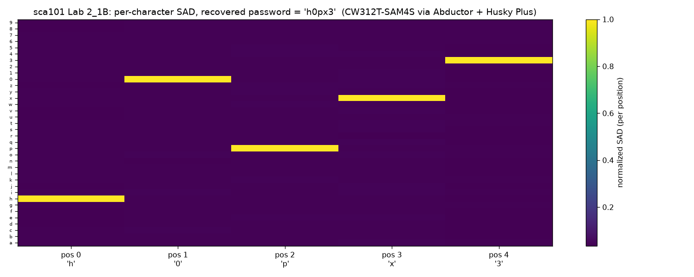

#### Lab 3_1: large Hamming weight swings

The target's power depends on the data it handles as well as on the code path. With `simpleserial-aes`
(TINYAES128C) and a fixed key, I captured 200 traces with plaintext byte 0 forced to `0x00` (Hamming
weight 0) or `0xFF` (Hamming weight 8). Bit 0 of the original random byte picks the value (odd gives
`0xFF`, even gives `0x00`), which splits the traces about evenly. The difference of the two group means
is the data-dependent leak. Script: [`lab_3_1.py`](validation/scripts/lab_3_1.py).

| Metric | Value |
|---|---|
| Traces | 200, about 100 at `0x00` and 100 at `0xFF` |
| Peak difference | 0.0254 in magnitude at sample 528 (negative) |
| Off-peak std (difference trace beyond ±400 samples from the peak) | 0.0008 |
| Leak-to-noise ratio | peak about 32x the off-peak std (an informal single-run ratio, not an SNR) |

A sharp negative spike at sample 528, where the target loads and processes that byte, dominates the
difference of means. The spike is negative because ChipWhisperer measures across a shunt: more power
reads as lower voltage, and `0xFF` (more bits set) draws more power than `0x00`. A smaller positive
spike, about +0.013 near sample 1930, lines up with the S-box output of the same byte. The Lab 3_3 DPA
peak sits at the same sample. The sign fits too, because `SBox(0xFF XOR 0x2b) = 0x48` has fewer bits set
than `SBox(0x00 XOR 0x2b) = 0xf1`. CPA on AES exploits that S-box leak, `HW(SBox(pt XOR key))`.

On the right-angle board the leak sits at the same sample 528, with a peak difference of 0.019 and a
leak-to-noise ratio of about 27x.

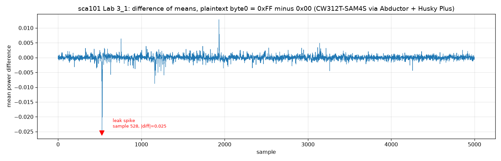

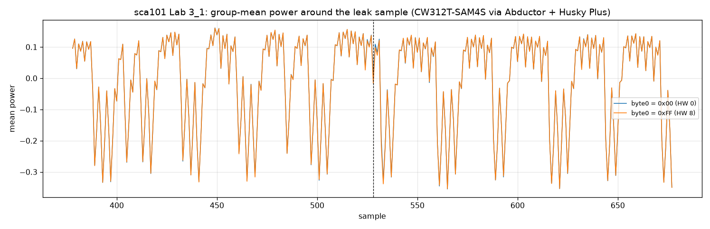

#### Lab 3_3: DPA on firmware implementation of AES

Single-bit DPA recovers the known key, `2b7e151628aed2a6abf7158809cf4f3c`, in all 16 bytes. This is the
first full key recovery in the suite. With `simpleserial-aes` (TINYAES128C) and a fixed key, I captured
2500 traces with random plaintexts, at about 119 traces/s. For each key byte and each of the 256 guesses,
the script splits the traces by bit 0 of `SBox(plaintext_byte XOR key_guess)` and subtracts the two group
means. The guess with the highest peak is the key byte. Script:
[`lab_3_3.py`](validation/scripts/lab_3_3.py).

For every byte the correct guess peaks above the best wrong guess. For byte 0 the correct guess `0x2b`
peaks sharply near sample 1930, at about 0.0033. The strongest wrong guesses reach about 0.0025 (`0x99`,
elsewhere in the trace) and about 0.002 (`0x40`, a ghost peak at the same sample). The margin is modest
because single-bit DPA is noisier than CPA.

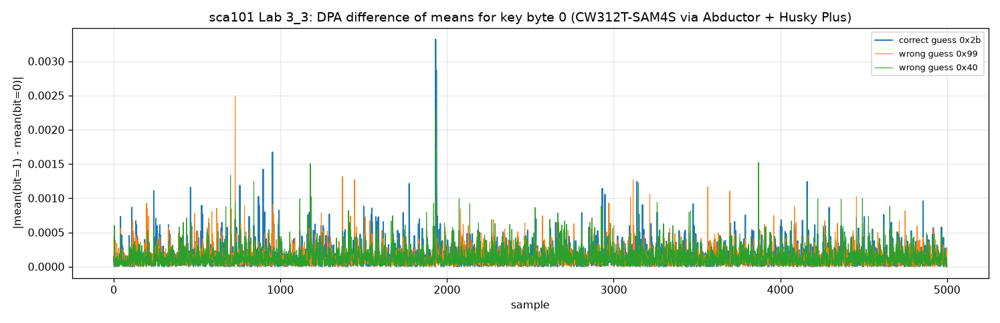

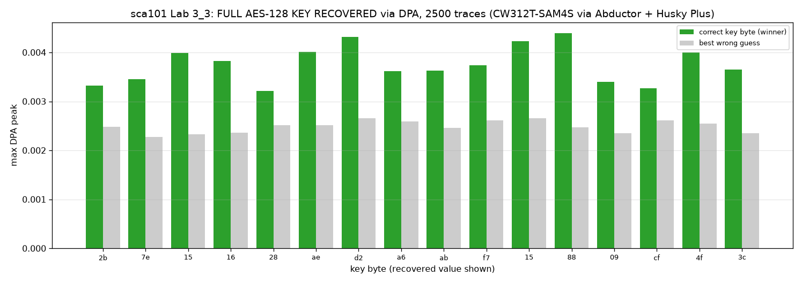

#### Lab 4_2: CPA on firmware implementation of AES

Correlation power analysis (CPA) recovers the same key, all 16 bytes, from the first 30 traces on all
three setups. It is the stronger attack here, since it is less noisy than single-bit DPA. The model is
`HW(SBox(plaintext_byte XOR key_guess))`, and for each key byte the guess whose model has the highest
absolute Pearson correlation with the traces (max |rho| over the samples) is the key byte. Script:
[`lab_4_2.py`](validation/scripts/lab_4_2.py).

- 1000 traces captured, at about 120 traces/s.
- The correct byte reaches |rho| 0.91 to 0.94 and the best wrong guess 0.20 to 0.31, so the correct byte
  leads by 0.6 to 0.7. The correct byte reaches 0.87 to 0.90 on the right-angle board and 0.89 to 0.91 on
  the CW313.
- 30 traces is the first point on the trace grid (..., 20, 30, 40, ...) where all 16 key bytes reach rank
  0.

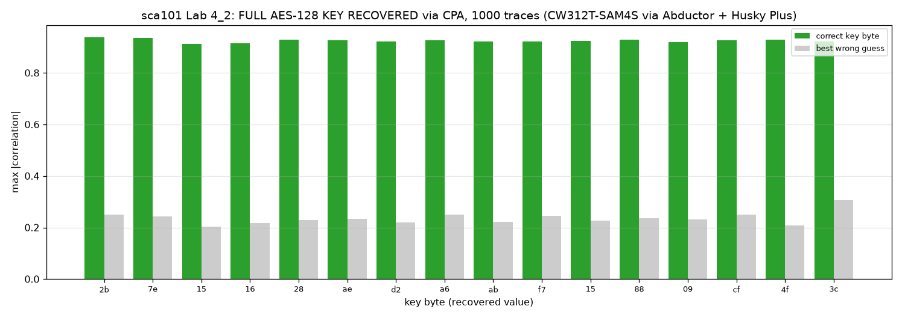

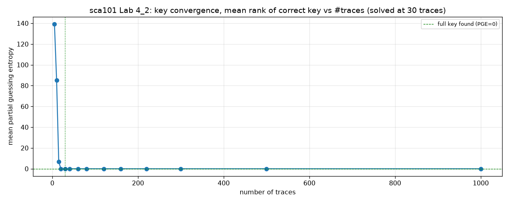

### SNR and TVLA

Two standard leakage metrics show how cleanly each path captures the AES leak. Script:
[`signal_integrity.py`](validation/scripts/signal_integrity.py), with a 3000-sample window on
`simpleserial-aes`. I ran it on all three setups at the same trace counts, so that only the path differs.

| Path | SNR peak, linear (dB) | TVLA max \|t\| |
|---|---|---|
| Straight board | 14.1 (11.5 dB) | 60.7 |
| Right-angle board | 14.0 (11.5 dB) | 59.5 |
| CW313 | 16.7 (12.2 dB) | 60.7 |

- SNR is `calculate_snr` from `chipwhisperer.analyzer`, with the Hamming weight of the S-box (SubBytes)
  output for byte 0 over 1500 random-plaintext traces, at the leak sample. ChipWhisperer's
  `calculate_snr(db=True)` returns `20*np.log(snr)`, and `numpy.log` is the natural log, so it reports
  `20*ln(snr)`, which is not standard dB. The dB values here are `10*log10` of the linear SNR (see
  `software/chipwhisperer/analyzer/attacks/snr.py`).
- TVLA is a non-specific fixed-vs-random Welch t-test, the leakage-detection method of Goodwill, Jun,
  Jaffe and Rohatgi (2011), later branded TVLA. It runs over about 1500 fixed and 1500 random traces
  (3000 total, split by a coin flip per trace), and the usual detection threshold is 4.5. A raw t value
  also grows with the trace count, so it is only a relative measure at matched counts.

The exact TVLA match between the straight board and the CW313, to three significant figures from two
independent trace sets, is chance and will not repeat to that precision. SNR is about 0.7 dB higher on
the CW313. With one estimate per path there is no spread to test that against, so a small real loss
through the Abductor is neither shown nor ruled out. The same holds for the somewhat smaller Lab 3_1 and
Lab 4_2 leaks on the right-angle board. Settling it would need repeated captures on each path.

SNR and TVLA come from the ChipWhisperer capture path, not from a direct bench measurement of the board.
I may later probe both boards directly with my MHO98 and an LD-ASP-2.7 single-ended active probe.

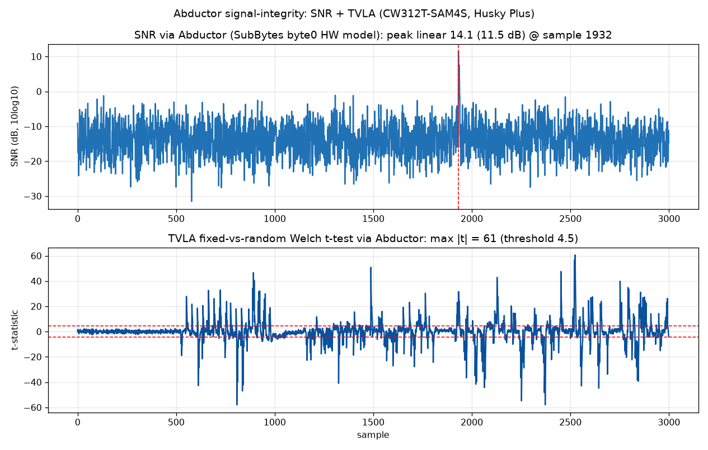

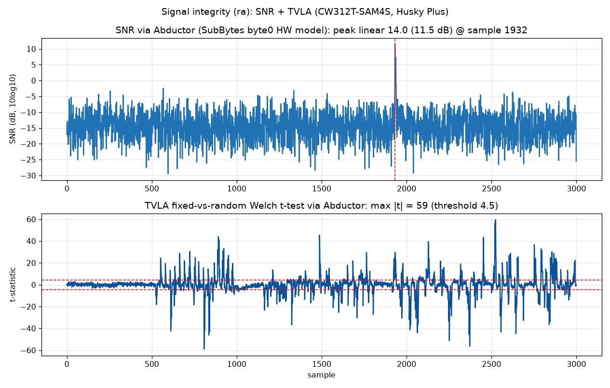

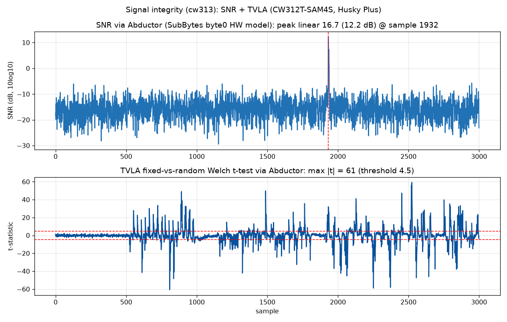

### Fault injection (fault101)

The glitch tests used the SMA tee from [Using the board](#using-the-board), stock UFO jumpers and the
stock SMA cables that ship with the Husky Plus and the CW313. The Husky Plus has a high-power and a
low-power crowbar MOSFET, and each one briefly shorts the target supply. This exercises the Abductor's
crowbar path, a different use of the power pins from power measurement.

#### Fault 2_2: voltage glitching to bypass password

`simpleserial-glitch` checks a fixed password (`touch`). A wrong password (`[0]*5`) normally returns
`passok=0`. A high-power crowbar glitch during the compare loop can leave `passok=1`, so the firmware
accepts the wrong password. That is a bypass. I used `scope.vglitch_setup('hp')`, with
`scope.io.vglitch_reset()` after each attempt, and swept widths 1900 to 2200, offsets 2380 to 2500 and
ext_offset 122 to 140, twice each: 2964 attempts. Bypasses appeared only at ext_offset 129, on both
boards:

| Board | Bypasses | Offsets | Widths |
|---|---|---|---|
| Straight | 12 in 2964 | 2460 to 2500 | 1900 to 2140 |
| Right-angle | 15 in 2964 | 2430 to 2500 | 1960 to 2200 |

Both windows reach the edge of the swept grid, so they may extend further. On the straight board the 12
bypasses are 0.4% of the whole grid, and 20% of the 60 attempts at offsets 2460 to 2500 and ext_offset
129 over all six widths. The window is a single ext_offset value, so a sweep with a coarse ext_offset
step misses it. [`fault_2_2_vglitch_find.py`](validation/scripts/fault_2_2_vglitch_find.py) finds the
first bypass with a sweep that is coarse in width and offset but steps ext_offset by 1, and
[`fault_2_2_vglitch_bypass.py`](validation/scripts/fault_2_2_vglitch_bypass.py) maps the window. The
shared VOUT tee and the SMA cabling may also narrow the window; I did not measure that.

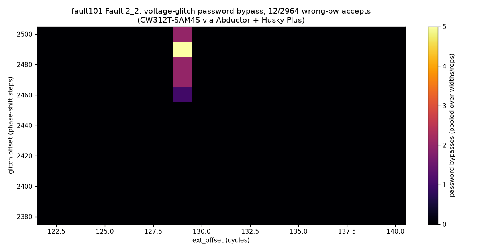

#### Bypass rate by tee and setup

In these tests the Abductor carried voltage glitching with either tee. I measure the peak bypass rate at
each setup's best cell: a fine search finds the cell, then 40 attempts run there. The best cell is the
best on the swept grid, not a verified global optimum.
[`vglitch_peakrate.py`](validation/scripts/vglitch_peakrate.py) runs this on a fixed grid (widths 1800 to
2200, offsets 2360 to 2520, ext_offset 128 to 130) and warns when the best cell sits on a width or offset
edge, where the rate comes out low.

| Setup | VOUT tee | Peak bypass rate |
|---|---|---|
| Straight board, back to back on one fresh re-assembly | Amphenol 132217 (low-cost SMA jack-plug-jack T, Mouser 523-132217) | 31/40 = 78% |
| Straight board, the same re-assembly | the tee that came with the UFO | 22/40 = 55% |
| Straight board, another re-assembly | Amphenol 132217 | 39/40 = 98% |
| CW313 | none (two dedicated SMAs) | 34/40 = 85% |

The right-angle board gave 36/40 = 90% at its best cell (95% CI about 76% to 97%), which overlaps the
straight board's 78% to 98% with the Amphenol tee.

The batch rate over 200 attempts (five 40-attempt batches,
[`vglitch_rate_robust.py`](validation/scripts/vglitch_rate_robust.py)) at each setup's best cell, found
the same day, is 49.5% through the straight board and 40.5% on the CW313. The 9-point gap is about 1.8
standard errors (standard error of the difference about 5 points, two-sided p about 0.07), so 200
attempts per setup cannot resolve it. These batch rates sit below the 40-attempt peaks:
`vglitch_rate_robust.py` picks its cell with a coarser search (2 attempts per cell, offset step 20), and
the peaks came from other assemblies.

With the Amphenol tee the Abductor is not measurably worse than the CW313: 31/40 and 39/40 against 34/40,
two-sided Fisher exact p 0.57 and 0.11. The stock-tee run (22/40) is lower than the CW313's 34/40 (p
about 0.007), but I measured them on different assemblies, and re-assembly moved the Amphenol rate from
31/40 to 39/40 (p about 0.014). So these single runs do not rank the setups.

The Amphenol tee may help, but that is not established. A two-sided Fisher exact test on the back-to-back
counts (31/40 against 22/40) gives p about 0.06, above the 0.05 level, so one pair of 40-attempt runs
cannot settle it. The 22.5-point gap is about the size of the 20-point spread between the two Amphenol
re-assemblies. Pinning down a modest tee effect would take repeated swap-and-measure runs.

#### Low-power crowbar

[`fault_2_2_vglitch_lp.py`](validation/scripts/fault_2_2_vglitch_lp.py) uses the low-power crowbar
(`scope.vglitch_setup('lp')`) at width 2000, offsets 2440 to 2470 and ext_offset 126 to 136, and sweeps
`scope.glitch.repeat` over 1, 2, 4 and 8, with 18 attempts each. At repeat 1 there were no crashes (0 of
18, too few to rule out a low rate). At repeat 2, 4 and 8 the crowbar crashed the SAM4S on every attempt.
The sharp threshold indicates that the crashes follow the glitch setting instead of happening at random.
The right-angle board and the CW313 showed the same threshold. Both crowbars drive the same CROWBAR SMA,
so this test exercises the same SMA and VOUT path as the high-power one, not the `FILT_LP` pin.

#### Fault 2_3: voltage glitching to memory dump

`bootloader-glitch` answers a command with an 8-byte ack, sending exactly `ascii_idx` bytes with
`for(i=0; i<ascii_idx; i++) putch(ascii_buffer[i])`. A crowbar glitch on that loop bound makes the target
keep sending past the ack and dump the adjacent buffer and RAM, which can include the decrypted
`data_buffer`. Script: [`fault_2_3_memory_dump.py`](validation/scripts/fault_2_3_memory_dump.py), with
[`fault_2_3_baseline.py`](validation/scripts/fault_2_3_baseline.py) to confirm the protocol and measure
the send-loop `trig_count`. Both scripts sample at one ADC sample per target clock, so `trig_count` and
ext_offset are both in target clock cycles.

- The glitch is a high-power crowbar pulse at width 2000, offset 2480 and ext_offset 2122, inside the
  send loop (`trig_count` 2159). It lands 37 cycles before the loop ends, near the final bound check.
- The 8-byte ack became a 510-byte dump with the leftover input buffer and a block of binary RAM. The
  success marker `767` that the attack looks for is at offset 0x2a, inside the leftover input, which is
  the encrypted command text. So the marker shows an overrun, and this dump does not contain the
  decrypted secret.
- The hexdump in [`fault_2_3_memory_dump.txt`](validation/evidence/fault_2_3_memory_dump.txt) shows 601
  bytes because the printed text was saved as UTF-8: each byte from 0xa1 to 0xff except 0xad takes two
  bytes there (91 `c2`/`c3` pairs).
- Success is rare. The first one came after about 2100 swept attempts. That is the position of one
  success in an ordered parameter sweep, not a per-attempt hit rate, so take it as an order of magnitude.
  The glitch has to break the loop bound in a narrow window.
- All three dumps are 510 bytes. The CW313's came at the same glitch point, with its first success also
  near 2100 swept attempts. The right-angle board's came at (1900, 2200, 88), much later in the sweep, at
  attempt 13049. That fits a rare fault with several valid glitch points, and shows that an early glitch
  can work too. It is the only dump in the repository that contains the decrypted secret,
  `Don't forget to buy milk!`
  ([`fault_2_3_memory_dump_ra.txt`](validation/evidence/fault_2_3_memory_dump_ra.txt)).

#### Fault 1_2: clock glitching to bypass password

In ChipWhisperer's stock configuration the CW312T-SAM4S core runs directly on the external HS2 clock. The
SAM4S HAL switches the master clock to MAINCK in bypass mode (about 7.37 MHz, prescaler 1) and keeps the
PLLA out of the core path: `firmware/mcu/hal/sam4s/sam4s_hal.c` calls `osc_enable(OSC_MAINCK_BYPASS)` and
then `pmc_switch_mck_to_mainck(SYSCLK_PRES_1)`. So a glitch on HS2 reaches the core clock tree (MCK/HCLK)
with no PLL to regenerate the clock. The capture clock runs in step with the 7.363636 MHz HS2 clock,
which agrees with this but does not by itself rule out a PLL. The proof is the HAL source, and the fact
that clock glitches fault the core.

On PLL-clocked systems the PLL strongly attenuates a single external clock glitch, so a naive
single-cycle glitch usually fails. Faults there come from disturbing the PLL itself, for example driving
it into a transient frequency overshoot by manipulating its reference clock. See Selmke, Hauschild and
Obermaier, "Peak Clock: Fault Injection into PLL-Based Systems via Clock Manipulation", ASHES@CCS 2019,
Fraunhofer AISEC / ACM, DOI 10.1145/3338508.3359577.

On the CW313 I swept at repeat 1 only: widths 3350 to 3600, six offsets from 2300 to 2900 and ext_offset
85 to 158, about 5300 attempts. The clock glitch crashes the SAM4S, more often as the width grows. One
clean bypass appeared at the crash onset, at (3450, 2300, 142). It was a single event, so it gives no
success rate. On the map at width 3450, every crash and the bypass sit at offset 2300, the lowest offset
swept, spread across ext_offset 88 to 157; offsets 2400 to 2900 show nothing.

Through the straight board, a sweep over widths 3400 to 4500, offsets 2300 to 2900 and ext_offset 85 to
157 faults the SAM4S too. It runs 400 attempts at each value of `scope.glitch.repeat`, the number of
consecutive glitched cycles:

| Repeat | 1 | 2 | 4 | 8 | 16 | 32 |
|---|---|---|---|---|---|---|
| Crash rate | 2% | 15% | 20% | 30% | 34% | 42% |
| Clean bypasses | 0 | 0 | 1 | 1 | 1 | 0 |

The right-angle board showed the same pattern: the crash rate rose from about 2% at repeat 1 to about 40%
at repeat 32, with some clean bypasses. A higher repeat raises the crash rate; three clean bypasses are
too few to show whether it also raises the clean-fault rate.

A sweep that misses the reactive offsets or widths sees no effect at all, which looks like the path is
attenuating the glitch. At repeat 1 the straight board gave no clean bypass in 400 attempts and the CW313
gave one in about 5300, which does not separate the two paths. These single, unmatched runs cannot show
whether the path makes any difference; that would need matched sweeps on both setups.

Scripts: [`clock_glitch_cw313_bypass.py`](validation/scripts/clock_glitch_cw313_bypass.py) for the CW313
and [`clock_glitch_abductor_repeat.py`](validation/scripts/clock_glitch_abductor_repeat.py) for the
repeat sweep. The repeat sweep script prints its counts; no script in the repository draws the repeat
figure. [`clock_glitch_characterize.py`](validation/scripts/clock_glitch_characterize.py) maps glitch
width to effect, and
[`clock_glitch_cw313_isolation.py`](validation/scripts/clock_glitch_cw313_isolation.py) sweeps width,
offset and ext_offset on the CW313 to check whether the SAM4S rejects clock glitches.

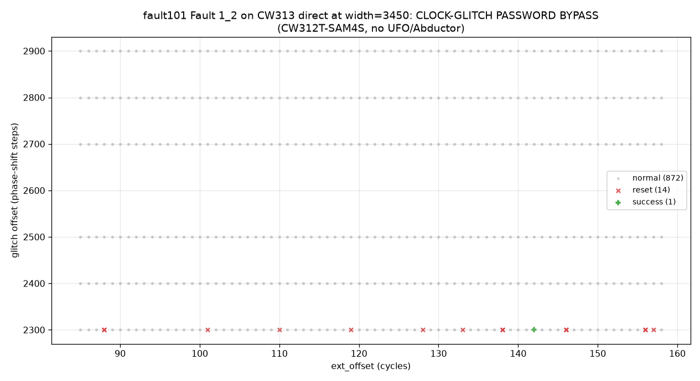

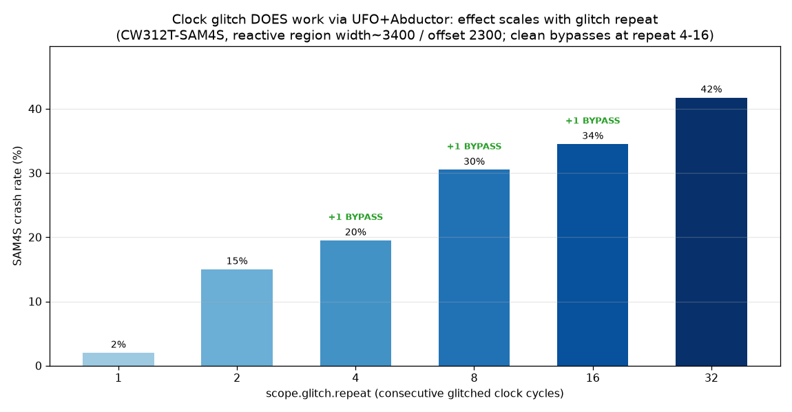

### SWD and JTAG debug

SWD and full JTAG both work through the Abductor. The SAM4S gives the same DPIDR, core revision, TAP
IDCODE and chip ID through both boards as on the CW313. So the Abductor carries all four JTAG signal
lines: the data lines TDI and TDO and the control lines TMS and TCK. `JTAG_nRST`, `JTAG_TRST` and
`JTAG_VREF` were not exercised.

With the Husky Plus in MPSSE mode (its FTDI emulation) and OpenOCD, I took over the SAM4S via SWD: reset
and halt at the reset vector, then read the chip ID, SRAM, flash and core registers. The Husky Plus
drives SWD in non-DIO mode (`scope.enable_MPSSE(1)`), which puts the debug signals on the main 20-pin
SPI/PDI pins: PDID is SWDIO and SCK is SWCLK, the same mapping the non-Husky ChipWhisperer boards use.
OpenOCD then connects with `transport select swd` and the `at91sam4sXX` target config. In MPSSE mode the
USB PID stays `0xace6`, and the interface config is the stock ChipWhisperer `openocd/cw_openocd.cfg`.
Scripts: [`swd_debug.sh`](validation/scripts/swd_debug.sh) and
[`jtag_debug.sh`](validation/scripts/jtag_debug.sh).

I verified the flow on the CW313 first, to check the target and the toolchain. There the JP3 caps make
the bridge, so no external wiring is needed: `PDID` to `JTAG_TMS`, `SCK` to `JTAG_TCK`, `MOSI` to
`JTAG_TDI`, `MISO` to `JTAG_TDO`, `nRST` to `JTAG_nRST` and `PDIC` to `JTAG_TRST`. SWD needs the first
two, full JTAG the first four. Through the Abductor the bridge is the `J8` wires listed in
[Using the board](#using-the-board). From `J8` the debug lines reach the CPU through the UFO target
socket, the Abductor and the CW312 card edge.

The schematics do not explain why SWD needs the `VREF` wire. The UFO does not drive `JTAG_VREF` itself;
it only feeds the 100k pull-ups on the JTAG lines. The CW312T-SAM4S ties card-edge pin A26 (`JTAG_VREF`)
to its VCC, and the Abductor routes A26 to the UFO's `JTAG_VREF`. On the CW313, `JTAG_VREF` also comes
only from A26. The wire feeds the same net as the A26 route, so these sessions cannot tell the two apart.

OpenOCD drove no reset line. The raw CW313 logs print `none separate`, the reset configuration that
`cw_openocd.cfg` leaves (`reset_config srst_push_pull`), and the at91sam4 target config resets the core
with `cortex_m reset_config sysresetreq`. The same scripts and configs ran through the Abductor, so wire
4 was not exercised there either. `J_TRST` also lands, through the Abductor, on card-edge pin A32, which
the CW312T-SAM4S leaves unconnected.

The SWD readout through the straight board:

| Read over SWD | Value | Meaning |
|---|---|---|
| SWD DPIDR | `0x2ba01477` | ARM CoreSight SW-DP (DPv1) alive. This DPIDR is common on Cortex-M4 parts and later Cortex-M3 revisions, and identifies the debug port, not the core |
| Core | `Cortex-M4 r0p1` | SAM4S core, from CPUID |
| State | `halted due to debug-request` | the debugger halted the core straight out of reset, at the reset vector |
| CHIPID_CIDR @0x400E0740 | `0x288b07e1` | chip ID read from silicon, which decodes to ATSAM4S2A (Cortex-M4, 128 KB flash, 64 KB SRAM) |
| Flash @0x00400000 | SP `0x200011a8`, reset vector word `0x0040061d` | firmware vector table. Bit 0 of the reset entry marks Thumb state, so the handler is at `0x0040061c` |
| Registers | pc `0x0040061c`, sp `0x200011a8` | pc is the reset handler and sp the vector-table MSP, as expected after a reset halt |

The DPIDR, the CPUID core revision and the chip ID match the CW313 bit for bit, and the halt, flash and
register reads behave the same. The vector table, pc and sp depend on the firmware and differ from the
CW313 run only because I loaded a different build there. On the right-angle board the core halts at pc
`0x00400180` with sp `0x20001020`, and the SRAM and flash sections of that log are empty. So SWDIO (on
the TMS pin) and SWCLK (on the TCK pin) carry SWD end to end from the CW312 card edge to the UFO socket.

SWD leaves TDI and TDO unused. To exercise `JTAG_TDI` and `JTAG_TDO` I repeated the session in full JTAG
mode (`transport select jtag`) with wires 5 and 6 added. OpenOCD scanned the chain:

| Read over JTAG | Value | Meaning |
|---|---|---|
| TAP IDCODE | `0x4ba00477`, matches expected | ARM CoreSight JTAG-DP (`mfg: 0x23b (ARM Ltd), part: 0xba00, ver: 0x4`), captured in Capture-DR and shifted out on TDO |
| Core | `Cortex-M4 r0p1` | same core, from CPUID over JTAG |
| CHIPID_CIDR @0x400E0740 | `0x288b07e1` | chip ID, read over JTAG |

The IDCODE comes out on TDO, so it confirms `JTAG_TDO` (the MISO wire). The halt, chip ID, flash and pc
reads that follow shift their commands in on TDI and return data on TDO, so they also exercise `JTAG_TDI`
(the MOSI wire). The right-angle board gives the same IDCODE and reads. As expected, the TAP IDCODE
`0x4ba00477` differs from the SWD DPIDR `0x2ba01477`: they are the ID registers of the JTAG-DP and the
SW-DP, the two modes of the same CoreSight SWJ-DP debug port. Unlike the IEEE 1149.1 IDCODE, the SW-DP
DPIDR has a DP-version field in bits [15:12], and it encodes PARTNO in 8 bits against the IDCODE's 16.

Evidence: [`swd_cw313_dump.txt`](validation/evidence/swd_cw313_dump.txt),
[`swd_abductor_dump.txt`](validation/evidence/swd_abductor_dump.txt),
[`swd_abductor_ra_dump.txt`](validation/evidence/swd_abductor_ra_dump.txt),
[`jtag_cw313_dump.txt`](validation/evidence/jtag_cw313_dump.txt),
[`jtag_abductor_dump.txt`](validation/evidence/jtag_abductor_dump.txt) and
[`jtag_abductor_ra_dump.txt`](validation/evidence/jtag_abductor_ra_dump.txt). The straight-board SWD and
JTAG files are edited summaries of the OpenOCD output; the CW313 files are the raw logs.

### Signal coverage

Every pin the Abductor routes was exercised by a test, checked for continuity, or is marked as not
exercised in the matrix. The functional tests run small firmwares on the SAM4S.
[`signal_test.py`](validation/scripts/signal_test.py) flashes a test firmware and, for GPIO3, reads TIO3
back on the Husky Plus; the LED check is visual. The firmware sources are
[`led-blink/`](validation/scripts/firmware/led-blink/) and
[`abductor-sigtest/`](validation/scripts/firmware/abductor-sigtest/), built under the chipwhisperer
`firmware/mcu/` tree. The pin map comes from the CW312T-SAM4S schematic.

`led-blink.c` drives the three target LED lines in sequence, and the three UFO LEDs light one after the
other. `abductor-sigtest.c` drives GPIO3 (PA8) as a slow square wave, and TIO3 in `scope.io.tio_states`
follows it (seen at both 0 and 1). Both work on the right-angle board too. The target's `SJ1` jumper is
not on the GPIO3 path: it selects whether ERASE/PB12 follows PDIC (the default, which SAM-BA programming
needs) or GPIO3. The same firmware outputs PCK0 (MAINCK/8) on PA6, which is CLK_FROM_SAM, the target
clock-out. The Husky Plus frequency counter does not read the UFO clock-out path without extra
clock-routing setup, so I checked CLKOUT for continuity instead.

| Abductor signal | SAM4S pin | Checked by |
|---|---|---|
| VCC1.2 (core), FILTIN, VCC3.3 (IO), IOVREF, SHUNTH | power net | SCA and power capture |
| SHUNTL (the UFO SMA node) | power net | power capture, voltage glitch (high- and low-power crowbar) |
| FILT_HP, FILT_LP | core supply, one node on the UFO and on the CW312T-SAM4S | power capture; the two run in parallel, so neither is checked alone |
| CLKIN (HS2) | XIN / PB9 | SCA and clock glitch |
| GPIO1_TX / GPIO2_RX | PA10 / PA9 | serial (password bypass) |
| GPIO4 / trigger | PA7 | capture trigger |
| nRST, PDIC (ERASE) | RST / PB12 | SAM-BA programming |
| JTAG TMS / TCK / TDI / TDO | PB6 / PB7 / PB4 / PB5 | SWD and full JTAG |
| JTAG_VREF | debug net | not separable: the VREF wire feeds the same net |
| JTAG_nRST | debug net | not exercised (OpenOCD drove no reset) |
| LED1 / LED2 / LED3 | PA16 / PA15 / PA14 | led-blink firmware (visual) |
| GPIO3 | PA8 | sigtest firmware (TIO3 read-back) |
| CLKOUT (CLK_FROM_SAM) | PA6 (PCK0) | continuity, CW312 edge A29 to UFO CLKOUT (silkscreen CLKFB) |
| SCK, MOSI, PDID (CS) | not used by the SAM4S | iCE40 bitstream load |
| MISO | not used by the SAM4S | not exercised |
| VCC1.8 / 2.5 / 5.0 | power net | continuity (unused by the SAM4S) |
| HDR1-10, JTAG_TRST | passthrough | continuity |

The SAM4S does not use the extra VCC rails or HDR1-10, so those nets and CLKOUT got a continuity check
from the CW312 edge to the UFO breakout. Every checked net was continuous.

The parallel ETM trace pins (TRACECLK, TRACED0-3) cannot be tested on this setup: the ATSAM4S2A has no
ETM (NewAE's "Husky TraceWhisperer Exploration" demo says it cannot be used with the SAM4S for that
reason). The CW312T-SAM4S schematic leaves those pins unconnected at the card edge, the Abductor leaves
them unrouted at its socket, and the UFO schematic, a 2016 design, has no trace pins either. SWO, the
SAM4S single-wire trace output, shares the `TDO/TRACESWO` pin, which the full JTAG test exercises as
`JTAG_TDO`.

## CW312T-iCE40UP FPGA

The CW312T-iCE40UP (a Lattice iCE40 UltraPlus iCE40UP5K FPGA, about 5280 LUTs, 30-ball WLCSP) is a
different class of target. Through the Abductor it gave the same attack outcomes as on the CW313, with
slightly different raw leakage metrics. It runs a hardware AES core in the FPGA fabric, is configured
with a bitstream over SPI, talks over the SimpleSerial v2 (SS2) wrapper, and leaks on the last AES round.
The repository has the CW313 convergence, TVLA and DFA results.

Take the SAM4S debug wires off the UFO `J8` header first ([Using the board](#using-the-board)). No iCE40
test needs them.

### Bring-up

The `iCE40UP5K_SS2` AES bitstream loads and the FPGA configures, so the Abductor routes the configuration
path: SCK, MOSI, the chip select on PDID and the reset on nRST. The loader only writes, and it does not
read CDONE on PDIC, so this target does not exercise MISO or PDIC. A known-answer test passes,
`AES(0,0) = 66e94bd4ef8a2c3b884cfa59ca342b2e`, so the SS2 serial and the clock reach the FPGA and the
core runs. Both steps pass on the right-angle board too.

### CPA and TVLA

[`ice40_hw_aes_cpa.py`](validation/scripts/ice40_hw_aes_cpa.py) runs CPA over 5000 traces with the
last-round Hamming-distance (HD) model, `cwa.leakage_models.last_round_state_diff`: the Hamming distance
between the round-9 and round-10 state-register values, valid for this round-based core that does one
round per cycle. It recovers the round-10 key, and the inverse key schedule gives the master key, 16/16
bytes correct (`2b7e151628aed2a6abf7158809cf4f3c`), on the right-angle board too.

That takes thousands of traces, against 30 for the SAM4S software AES. The FPGA core completes a full
round in one clock cycle with all 16 S-boxes switching at once. So the other 15 bytes add algorithmic
noise, and the SNR of any single byte is far lower than in the software AES, whose S-box lookups run in
turn over many cycles. The hardware AES still leaks overall, as the TVLA shows.

[`ice40_sca_metrics.py`](validation/scripts/ice40_sca_metrics.py) measures two metrics:

- CPA convergence with the same model reaches the full key by 3000 traces, the next grid point after 2000
  (8/16 bytes at 700 traces, 15/16 at 2000). The 5000 traces of the CPA run are a safety margin.
- A non-specific TVLA (about 2000 + 2000 traces) gives max |t| = 85.0 against the 4.5 threshold, a
  first-order leak through the Abductor's power path.

Plots: [`ice40_cpa_convergence.png`](validation/img/ice40_cpa_convergence.png) and
[`ice40_tvla.png`](validation/img/ice40_tvla.png). On the CW313 the full key also falls by 3000 traces
(14/16 at 2000) and TVLA gives max |t| = 89.3 against 85.0, so the two paths were close
([`cw313/ice40_cpa_convergence.png`](validation/img/cw313/ice40_cpa_convergence.png),
[`cw313/ice40_tvla.png`](validation/img/cw313/ice40_tvla.png)).

On the right-angle board the first convergence run needed 5000 traces for the last, weakest key byte, and
a repeat reached the full key by 3000 like the straight board. That is most likely run-to-run variation
on the weakest byte of a parallel hardware AES, but one repeat cannot rule out an effect of the
right-angle board. Its TVLA gives max |t| = 85.8. The right-angle figures are under `validation/img/ra/`.

### Fault attack (DFA)

A clock glitch on HS2, the FPGA's clock, faults the AES core, and a differential fault attack (DFA) on
those faults recovers the full key on all three setups. The attack follows the official ChipWhisperer DFA
lab (`fault201 Lab 1_3B - DFA Attack on AES`) and uses the same cracker, `phoenixAES` (Philippe Teuwen's
tool, in the JeanGrey repository of the SideChannelMarvels project).

Before the glitch campaign, [`dfa_selftest.py`](validation/scripts/dfa_selftest.py) checks both fault
models offline. Its software AES gives `AES(0,0) = 66e94bd4...` (asserted) and
`AES(2b7e..,00..0f) = 50fe67cc996d32b6da0937e99bafec60`, printed next to the value the FPGA returned on
the bench. It then recovers the key from simulated round-9 and round-8 faults.

A round-9 fault (Piret and Quisquater) is a single-byte fault just before the last MixColumns, and it
gives a 4-byte diagonal ciphertext difference (for example bytes 0/7/10/13). This works, but the FPGA
runs a parallel AES, so a fixed plaintext faults only one data-dependent diagonal. Getting all four
diagonals this way was impractical here: one diagonal was very rare across the plaintexts I tried, though
more plaintexts might bring it out.

A single-byte fault one round earlier, in round 8, diffuses fully. `phoenixAES.convert_r8faults_bytes`
turns one such output into round-9 faults on all four diagonals at once, so a few clean round-8 faults
are enough in principle. On hardware, [`ice40_dfa_phoenix.py`](validation/scripts/ice40_dfa_phoenix.py)
keeps every output with 14 or more changed bytes as a round-8 candidate (129 for the known-answer
plaintext on the straight board), and it also keeps the clean round-9 faults. It merges what phoenixAES
cracks from both into one key. On the straight board the known-answer plaintext gave 12 of 16 round-10
key bytes (diagonals 0, 1 and 2) and a second plaintext gave the last diagonal. On the right-angle board
and the CW313 the known-answer plaintext gave all 16.

The recovered round-10 key is `d014f9a8c9ee2589e13f0cc8b6630ca6`. Inverting the key schedule
(`aes_funcs.key_schedule_rounds(r10, 10, 0)`) gives the master key `2b7e151628aed2a6abf7158809cf4f3c`,
16/16 bytes correct. The script writes the evidence:
[`ice40_dfa_abductor.txt`](validation/evidence/ice40_dfa_abductor.txt),
[`ice40_dfa_ra.txt`](validation/evidence/ice40_dfa_ra.txt) and
[`ice40_dfa_cw313.txt`](validation/evidence/ice40_dfa_cw313.txt). Each file lists the first six round-8
candidates per plaintext. None of those is a clean single-byte round-8 fault: checked against the known
key, each differs in 3 or 4 bytes of every column before the last MixColumns, where a clean one differs
in exactly one. The files do not record the faults that produced the key.

## CW312T-K82F crypto accelerator

The CW312T-K82F (NXP Kinetis MK82FN256, a Cortex-M4F) is a third class of target. Through both boards and
on the CW313 it leaks clearly in TVLA, and first-order CPA does not recover its key on any setup. The
K82F has three AES engines: the mmCAU (Memory-Mapped Cryptographic Acceleration Unit), the separate LTC
(LP Trusted Cryptography) co-processor, and the OTFAD on-the-fly flash decryption engine, which is not
used here. The attacks target the mmCAU hardware AES (`CRYPTO_OPTIONS=MMCAU`), a throughput accelerator
for software crypto with no DPA or side-channel countermeasure of its own. The K82F's hardware DPA
countermeasure lives in the LTC, which the DPA-mask study covers. So when an attack fails on the mmCAU,
the cause is effort, model or low per-byte SNR, not a designed-in resistance.

The CW312T-K82F also wires its ETM trace port (PTA12 to PTA16) to the card-edge TRACECLK and TRACED0-3
pins, which the Abductor leaves unconnected. For parallel trace from this target, use the CW313, whose
`HDR2` header brings those pins out.

### Bring-up

I flashed the K82F over SWD through the Abductor, with the Husky Plus in MPSSE mode and OpenOCD
(`kx.cfg`), over the same debug path as the SAM4S SWD test (the `J8` wires in
[Using the board](#using-the-board)). The K82F also has an on-chip ROM serial bootloader (KBOOT, entered
by pulling PTA4 low, over UART or USB), but NewAE recommends flashing this target over SWD or JTAG. A
known-answer test then passes, `AES(2b7e..,00..0f) = 50fe67cc996d32b6da0937e99bafec60`, so the SWD flash,
the 7.37 MHz HS2 clock, the LPUART serial and the trigger all reach the K82F through the Abductor, and
the mmCAU AES runs. On the right-angle board OpenOCD detects the Kinetis MK82FN256, the flash verifies OK
and the known-answer test passes.

Scripts: [`k82f_flash.sh`](validation/scripts/k82f_flash.sh) and
[`k82f_bringup.py`](validation/scripts/k82f_bringup.py). Firmware:
[`validation/scripts/firmware/k82f/`](validation/scripts/firmware/k82f/), the mmCAU AES built with
`PLATFORM=CW308_K82F CRYPTO_TARGET=HWAES CRYPTO_OPTIONS=MMCAU SS_VER=SS_VER_2_1`, plus the three LTC
builds of the mask study.

### TVLA and CPA

A non-specific fixed-vs-random Welch t-test on the mmCAU AES gives max |t| = 100.6 over 8000 traces, far
above 4.5, so the Abductor's power path captures data-dependent activity in the window. Script:
[`k82f_tvla.py`](validation/scripts/k82f_tvla.py), which saves `validation/img/k82f_tvla_*.png`.

Despite that leak, standard first-order CPA did not break the mmCAU AES, up to 50k traces, blind or
profiled. With the known key as an oracle:

- Byte 0 leaks clearly (|rho| = 0.104).
- Bytes 8 and 14 leak weakly (0.04 to 0.06).
- The other thirteen sit at the noise floor (|rho| about 0.02).

A blind full-window CPA gets the correct guess for about 4 of 16 bytes. Three of those are the leaky
bytes (0, 8, 14), and the rest fit lucky noise peaks over the full window. A byte counts if either of two
models picks it, so random guessing would place about 0.12 bytes correctly (16 times (1 - (255/256)^2)).
So the four, far above chance, are a few leaky bytes plus false positives. The disjoint-set attack, a
profiled attack that builds its profile on one half of the traces and scores the other half, recovers at
most 1 of 16. No first-order correlation attack I tried recovered the full key with this setup. A
stronger attacker, a better model or more traces might.

A self-profiled matched-filter or point-of-interest attack reports a false or near 16/16, because it
builds the profile from the same traces it then scores and so fits their noise. Only the disjoint-set
attack gives the real figure. [`k82f_mf_convergence.py`](validation/scripts/k82f_mf_convergence.py)
reports 16/16 by construction, and the point-of-interest step of
[`k82f_cpa_break.py`](validation/scripts/k82f_cpa_break.py) is biased toward 16/16 in the same way. They
are in the repository as the circular counter-example to the disjoint-set attack and do not show a key
recovery.

Scripts: [`k82f_cpa.py`](validation/scripts/k82f_cpa.py) (blind CPA with a first-round and a last-round
model), [`k82f_leakcheck.py`](validation/scripts/k82f_leakcheck.py) (known-key leakage locator),
[`k82f_models.py`](validation/scripts/k82f_models.py) (only its blind method A counts; its methods B to D
are self-profiled, as its header says) and [`k82f_mf_rigor.py`](validation/scripts/k82f_mf_rigor.py), the
disjoint-set attack. The plot `validation/img/k82f_mmcau_cpa_convergence.png` comes from
`k82f_mf_rigor.py`. Its 4/16 line is a fixed reference for the blind result. `k82f_cpa.py` writes its own
blind-CPA plot, `k82f_mmcau_cpa_blind.png`.

### Control runs on the CW313 and the right-angle board

To check whether the K82F itself or the Abductor limits the attack, I repeated the 50k-trace experiment
with the K82F in the CW313 ([`k82f_compare.py`](validation/scripts/k82f_compare.py)). The outcome
matches: byte-0 |rho| is 0.104 through the straight board and 0.095 on the CW313, the same few bytes
leak, and neither setup recovers the full key, so the limit is the target. The CW313 capture was noisier
(median per-sample std 6.1e-3 against 4.0e-3) and its TVLA lower (65.8 against 100.6, both at 8000
traces). So in this session the Abductor did not degrade the measurement and was, if anything, the
cleaner of the two.

[`k82f_ra_compare.py`](validation/scripts/k82f_ra_compare.py), written for the right-angle board,
captures 30k traces there and runs the same analysis on the straight and CW313 trace caches, all capped
at 30k. Its columns include `byte0 |rho|`, `blind`, `rigorous` (the disjoint-set attack) and `noise` (the
median per-sample std):

| Setup | Byte-0 \|rho\| | Median per-sample std | Disjoint-set attack |
|---|---|---|---|
| Right-angle board | 0.104 | 4.01e-3 | 0/16 |
| Straight board | 0.104 | 4.02e-3 | 0/16 |
| CW313 | 0.091 (0.095 at 50k) | 6.11e-3 | 0/16 |

The two boards tie on |rho| and on noise by chance. On the right-angle board TVLA gives max |t| = 96.0 at
8000 traces, and first-order CPA fails as on the straight board. So the failure is the target's, and the
right-angle board added no distortion this comparison could measure.

### LTC DPA mask (inconclusive)

The LTC has a hardware DPA mask (`LTC_SetDpaMaskSeed`). NXP's SDK says the mask should be seeded at
power-on reset (the NewAE HAL seeds it from the TRNG) and recommends that software reseed it every 50000
blocks; the masking continues even without a reseed. I compared three LTC builds on the same chip: the
mask seed held constant (off), the stock reseed every 50000 blocks (on), which never fires within the
15000-trace default run, and a reseed on every encryption (active). For each sample, the metric is the
RMS over the 16 known-key byte correlations. All three builds peaked at about 0.03, with no first-order
difference this single-run comparison could resolve (I ran no significance test). The unmasked plaintext
and ciphertext I/O dominates the measured leak. Isolating the masked interior would need a middle-round
or higher-order attack, which is out of scope here. Scripts:
[`k82f_mask_study.py`](validation/scripts/k82f_mask_study.py) and
[`k82f_mask_variance.py`](validation/scripts/k82f_mask_variance.py).

## Reproducing the results

Everything is under `validation/`: scripts in `validation/scripts/`, figures in `validation/img/`, and
text evidence (OpenOCD readouts, memory dumps, DFA logs) in `validation/evidence/`. CW313 results are in
`validation/img/cw313/` and in the figures and evidence files named `*_cw313*`. Right-angle results are
in `validation/img/ra/` and in the figures and evidence files named `*_ra*`.

### Test bench

| Hardware | Detail |
|---|---|
| Capture | ChipWhisperer Husky Plus, USB `2b3e:ace6`, SN `50203220573555303230333230313036` |
| Husky Plus firmware | FW `1.2.0`, FPGA build `2026-05-22 12:13` |
| Carrier | CW308 UFO |
| Adapter | Abductor, straight and right-angle boards |
| Reference | CW313 baseboard |
| Primary target | CW312T-SAM4S (Microchip, ex-Atmel, ATSAM4S2A, Arm Cortex-M4 without FPU), `PLATFORM=CW312_SAM4S` |
| Other targets | CW312T-iCE40UP, CW312T-K82F |
| Target clock | `scope.default_setup()` requests 7.37 MHz on HS2 (`scope.io.hs2='clkgen'`); the Husky Plus clock generator produces 7.363636 MHz, a quarter of the 29.454545 MHz ADC rate (`adc_mul=4`) |
| ADC | 29.454545 MHz (`adc_mul=4`), 12 bit; the Fault 2_3 scripts set `adc_src='clkgen_x1'` (one sample per target clock) |
| Dates | 2026-07-18 (straight board, iCE40, K82F), 2026-07-19 (right-angle board) |

On the UFO, HS2 reaches the target CLKIN through the UFO's clock routing.

| Software | Version |
|---|---|
| OS | Ubuntu 26.04 LTS, kernel `7.0.0-28-generic`, x86_64 |
| chipwhisperer repo | branch `develop`, commit `3c8e4347507376d88f2e072fd39df28b380dd713` (`3c8e4347`, 2026-06-17) |
| Commit subject | `Wait after setting trace/UARTTtrigger.fe_clock_src` |
| `jupyter` submodule (notebooks) | `fe7e2aa1585798c3a5a6b247f231abe2e2b4a2cd` |
| chipwhisperer package | `6.0.0` (editable install) |
| Python (venv) | `3.12.13`, created with `uv 0.11.29` |
| Python (system) | `3.14.4`, not used: `numpy 1.26.4` ships no 3.14 wheels and did not build from source here |
| numpy | `1.26.4` |
| ARM toolchain | xpack `arm-none-eabi-gcc 13.3.1` |
| OpenOCD | `0.12.0` |
| SimpleSerial | `SS_VER_1_1` (the default) for bring-up and Labs 2_1A and 2_1B; `SS_VER_2_1` for the AES labs, SNR/TVLA, glitching, signal tests and the K82F |
| SAM4S programmer | SAM-BA (`cw.programmers.SAM4SProgrammer`, erase pin `pdic`) |

### Running the scripts

Run the scripts with Python 3.12 in a venv with ChipWhisperer installed from its repository, plus the
packages the scripts import. `phoenixAES` is needed only by `ice40_dfa_phoenix.py` and `dfa_selftest.py`:

```bash
python -m pip install -e /path/to/chipwhisperer numpy==1.26.4 matplotlib phoenixAES
```

Then run a script directly, for example `python validation/scripts/lab_2_1A.py`. The scripts use the
fixed AES key of the ChipWhisperer demos and hard-code absolute paths from my machine. Change these
before you run them:

| Variable | Points to | Used by |
|---|---|---|
| `TC` | the `bin` folder of the xpack ARM toolchain | the scripts that build SAM4S firmware |
| `FWDIR`, `HEX` | the ChipWhisperer firmware folder and the hex to flash | the SAM4S scripts |
| `OUT` | the folder for figures and logs | most capture scripts |
| `CACHE`, `SCR` | a local folder for the K82F trace caches | the K82F scripts |
| `VENV`, `OCDDIR` | the venv's Python and the folder with `cw_openocd.cfg` | `swd_debug.sh`, `jtag_debug.sh`, `k82f_flash.sh` |

This lists every hard-coded path, including the few outside these variables, such as the ChipWhisperer
project path in `ice40_hw_aes_cpa.py`:

```bash
grep -n -E '/home/dreg|/tmp/claude' validation/scripts/*.py validation/scripts/*.sh
```

The bring-up, lab and signal-integrity scripts, `fault_2_2_vglitch_find.py` and
`clock_glitch_abductor_repeat.py` build their SAM4S firmware for `PLATFORM=CW312_SAM4S` with the xpack
ARM toolchain, which they prepend to `PATH`. The other glitch and memory-dump scripts flash a prebuilt
`simpleserial-glitch` or `bootloader-glitch` hex, or expect that firmware already on the target, so build
those first.

Many capture scripts take an optional label as their first argument, such as `cw313` or `ra`. The label
does not change the setup: for a CW313 or right-angle run you move the target yourself and pass the
matching label. Some scripts take a different first argument.

| Script | First argument | What it does with it |
|---|---|---|
| `smoke_bringup.py`, the `lab_*.py` scripts, `fault_2_2_vglitch_bypass.py`, `ice40_sca_metrics.py` | label | saves the figures in a subfolder named after it, for example `lab_3_3.py ra` |
| `signal_integrity.py`, `k82f_tvla.py` | label | adds it to the figure name (`signal_integrity_ra.png`) |
| `ice40_dfa_phoenix.py` | label | adds it to the evidence file name (`ice40_dfa_ra.txt`) |
| `ice40_hw_aes_cpa.py` | label | names its ChipWhisperer project |
| the `vglitch_*.py` scripts | label | only prints it |
| `k82f_cpa.py` | label | picks its trace cache |
| `k82f_leakcheck.py`, `k82f_models.py`, `k82f_compare.py`, `k82f_ra_compare.py`, `k82f_cpa_break.py` | trace count | |
| `signal_test.py` | hex path | |

The SAM4S figures in `validation/img/cw313/`, `signal_integrity_cw313.png` and
`k82f_tvla_cw313_mmcau.png` name the Abductor in their titles, which is wrong for those CW313 runs. The
scripts take the setup name for their titles from the label, so a run with the `cw313` label is titled
`on CW313` and one with `ra` `via right-angle Abductor`. The right-angle and CW313 iCE40 DFA logs carry a
setup line that `ice40_dfa_phoenix.py` does not write.

## Troubleshooting

- If the target does not answer at all, check the UFO settings in
  [UFO jumpers and switches](#ufo-jumpers-and-switches): J3 on HS2/OUT to CLKIN, the 3.3V SRC switch on
  J1/CW, the 1.2V LDO SRC switch on J1 for the SAM4S and the iCE40, J14 on FILT, J16 open and a cap on
  J4.
- No sudo is needed for the toolchain. I extracted the xpack ARM toolchain under my home directory and
  prepend its `bin` to `PATH` before running `make`.
- The stock NewAE udev rule assigns the `chipwhisperer` group and needs a re-login. I switched it to
  `plugdev`, which I was already in, for immediate USB access.
- Sometimes the SAM4S does not drop into SAM-BA and the programmer reads a garbage chip ID, which is the
  running firmware's UART text leaking into the bootloader handshake. Reconnecting the Husky Plus USB
  clears it, and programming then works on the first try. It is a known intermittent SAM-BA issue, not
  specific to the Abductor: it happens on the straight board, the right-angle board and the CW313.
  Bring-up and Labs 2_1A and 2_1B flashed cleanly many times before I first saw it, on the AES labs. On
  the right-angle board it stopped Lab 3_1 once, and the test passed on the retry.
- If a voltage-glitch sweep finds no bypass, step ext_offset by 1. The bypass window in
  [Fault 2_2](#fault-2_2-voltage-glitching-to-bypass-password) was a single ext_offset value, 129.
- Flashing `bootloader-glitch` for the memory dump can hang the SAM-BA programmer when an earlier test
  left the SAM4S debug-halted or crashed. `fault_2_3_memory_dump.py` toggles `scope.io.nrst` low and then
  high-Z just before `program_target`, which resets the SAM4S out of that state. `program_target`'s own
  ERASE-pin and reset sequence then reaches SAM-BA.
